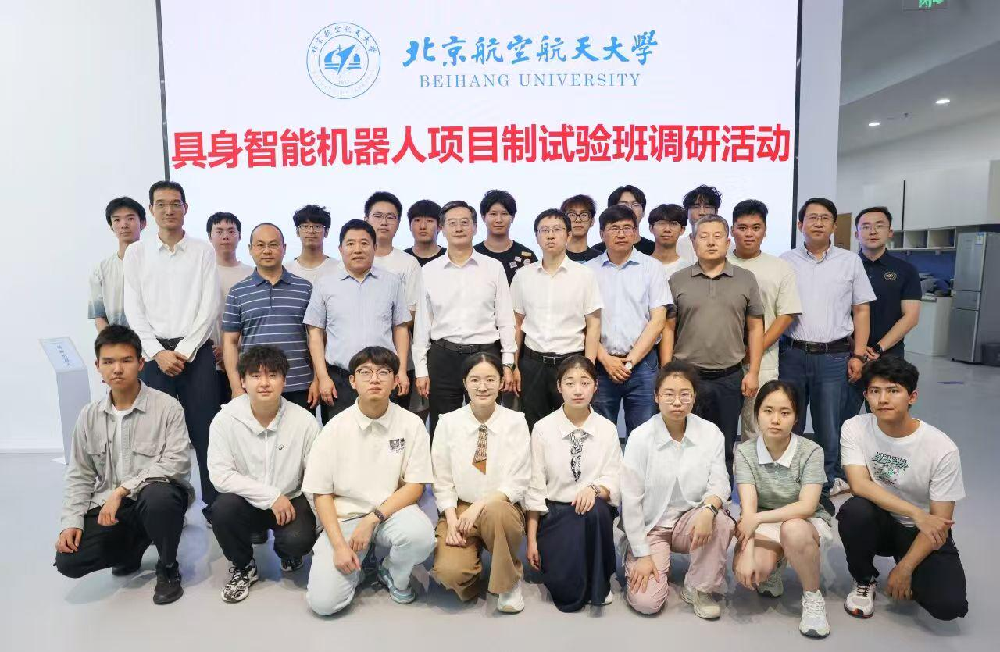
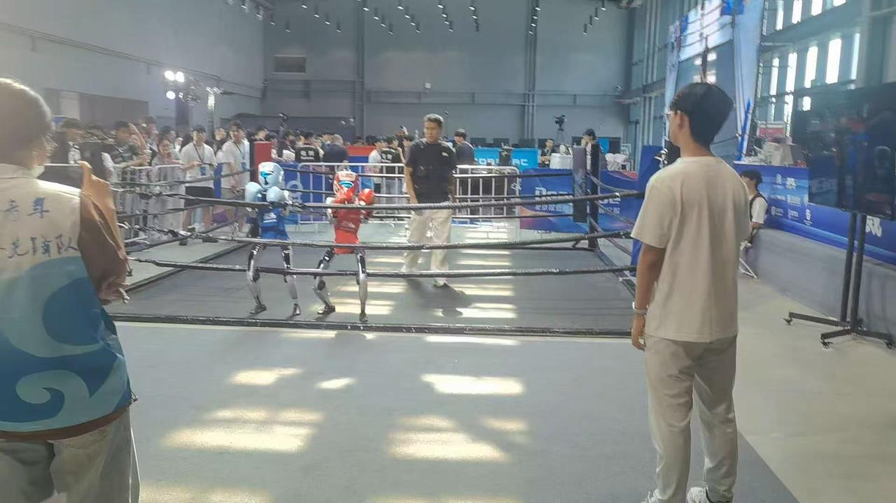
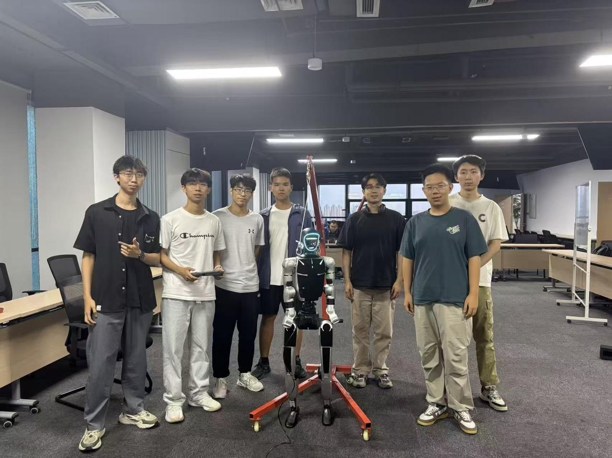

# Humanoid Robot Deployment

人形机器人部署工具、资源和sim2real部署包集合。

## 📦 项目组成

### 1. G9 Flying Kick Deployment (`g9_handoff/`)
G9机器人飞踢动作的sim2real部署包
- **训练好的策略**: ONNX格式，即可部署
- **参考动作**: NPZ格式运动数据
- **配置文件**: 环境和训练参数
- **验证工具**: sim2sim对齐脚本

```
g9_handoff/
├── deploy/          # 部署用ONNX模型
│   └── policy.onnx
├── motion/          # 动作数据
│   ├── G9_rightfeiti_tail_direct_v2.npz
│   └── G9_default_stance.csv
├── config/          # 配置参数
│   └── params/
├── sim2sim/         # 仿真验证
│   └── run_policy_mujoco_sim2sim_aligned_v2.py
└── README.txt
```

### 2. G9 Deployment Tools (`g9_deployment_tools/`)
G9机器人C++控制系统集成工具和补丁
- **patch_g9_b_static_asym_balance.py** - 静态非对称平衡补丁
- **add_g9_to_cpp_action_set.py** - 添加G9动作集到C++
- **patch_g9_b_imu_stabilizer.py** - IMU稳定器集成
- **install_g9_into_classmate_deploy.py** - 同学版本部署安装器
- **patch_g9_g_b_k_state_mimic.py** - 三阶段控制补丁 (G→B→K)
- **play_clean_target_push.py** - 播放和测试工具

**使用示例**:
```bash
cd g9_deployment_tools
python3 patch_g9_b_static_asym_balance.py  # 添加平衡控制
python3 add_g9_to_cpp_action_set.py        # 集成动作集
```

### 3. Unitree Robot Resources (`unitree_resources/`)
Unitree G1人形机器人完整模型资源库
- **23DOF/29DOF配置** - 多种自由度配置
- **URDF模型** - 机器人描述文件
- **MuJoCo XML** - 仿真场景文件
- **STL网格** - 完整的可视化模型
- **关节配置** - JSON格式关节数据

```
unitree_resources/
└── resource/
    └── g1_description/
        ├── g1_29dof.urdf
        ├── g1_23dof.urdf
        ├── g1_29dof_with_hand.urdf
        ├── scene_29dof_official.xml
        ├── meshes/              # 200+ STL文件
        └── inspire_hand/        # 手部模型
```

## 🚀 快速开始

### G9飞踢部署

1. **验证sim2sim对齐**
```bash
cd g9_handoff/sim2sim
python3 run_policy_mujoco_sim2sim_aligned_v2.py
```

2. **部署到真实机器人**
- 使用 `deploy/policy.onnx`
- 参考 `motion/G9_default_stance.csv` 设置初始姿态
- 检查关节映射和观测顺序

### 使用Unitree模型

```python
# 在MuJoCo中加载G1模型
import mujoco
model = mujoco.MjModel.from_xml_path(
    'unitree_resources/resource/g1_description/scene_29dof_official.xml'
)
```

## 📋 部署清单

在部署到真实硬件前，请验证：
- ✅ 关节顺序匹配
- ✅ 观测空间对齐
- ✅ 动作缩放正确
- ✅ 默认关节姿态
- ✅ 刚度/阻尼参数
- ✅ 紧急停止行为
- ✅ sim2sim验证通过

## 🔧 工具说明

### G9部署工具详解

**三阶段控制 (G→B→K)**:
- **G (Go)**: 初始状态，准备执行
- **B (Balance)**: 平衡保持状态
- **K (Kick)**: 运动执行状态

**补丁应用流程**:
1. 备份原始文件（自动）
2. 应用补丁修改
3. 验证修改结果
4. 重新编译项目

⚠️ **注意**: 所有补丁脚本会自动创建备份文件，但请在测试环境中先验证。

## 📊 模型规格

### G9飞踢策略
- **输入**: 154维观测向量
- **输出**: 29维动作（关节位置）
- **频率**: 50Hz
- **格式**: ONNX (优化的推理)
- **大小**: < 50MB

### Unitree G1模型
- **自由度**: 23/29可选
- **重量**: ~47kg
- **高度**: ~1.3m
- **手部**: 可选Inspire Hand
- **传感器**: IMU, 关节编码器, 力传感器

## 🔗 相关项目

- [humanoid-robot-research](https://github.com/ddldier/humanoid-robot-research) - 训练和研究代码
- [BeyondMimic](https://github.com/HybridRobotics/whole_body_tracking) - 上游项目

## 📝 文件说明

### ONNX模型
- `policy.onnx` - 主策略网络
- 使用ONNX Runtime或TensorRT加载
- 支持GPU加速推理

### NPZ动作文件
- 包含: 位置、速度、时间戳
- 使用numpy加载: `np.load('motion.npz')`
- 包含元数据和关节名称

### CSV配置
- 关节默认姿态
- 使用pandas读取
- 可直接发送到机器人控制器

## 🛠️ 技术栈

- **机器人**: Unitree G1, G8, G9
- **仿真**: MuJoCo, Isaac Sim
- **部署**: ONNX Runtime, C++ SDK
- **语言**: Python 3.10, C++17

## 📄 许可证

MIT License

## 👥 维护者

- 王浩然 (ddldier)

---

**GitHub**: https://github.com/ddldier/humanoid-robot-deployment  
**训练代码**: [humanoid-robot-research](https://github.com/ddldier/humanoid-robot-research)

## Robotac 媒体

### 图片





### 视频

- [Robotac 视频 1](docs/showcase/robotac/robotac_video_01.mp4)
- [Robotac 视频 2](docs/showcase/robotac/robotac_video_02.mp4)
- [Robotac 视频 3](docs/showcase/robotac/robotac_video_03.mp4)
- [Robotac 视频 4](docs/showcase/robotac/robotac_video_04.mp4)
- [Robotac 视频 5](docs/showcase/robotac/robotac_video_05.mp4)
- [Robotac 视频 6](docs/showcase/robotac/robotac_video_06.webm)
